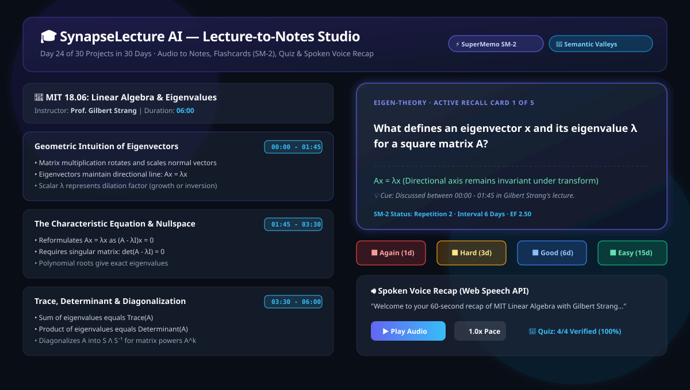
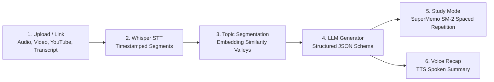

# SynapseLecture AI: Lecture-to-Notes Studio

> *"Drop in a lecture recording; get structured notes, flashcards, a quiz, and a voice summary."*  
> **Day 24 of 30 Projects in 30 Days** | **Domain:** EdTech + Speech + GenAI | **Level:** Intermediate

[](https://python.org)
[](https://streamlit.io)
[](LICENSE)
[](tests/)
[](Dockerfile)

---

## 1. Overview & Problem Statement

Standard AI transcription and summary tools output a monolithic **wall of text**. Students cannot effectively study from unsegmented transcripts because:
1. Lectures shift across multiple subtopics without clear conceptual boundaries.
2. Passive reading yields poor memory retention compared to **Active Recall** and **Spaced Repetition**.
3. Students lack rapid self-assessment to pinpoint weak areas before exams.

**SynapseLecture AI** transforms raw lecture audio, video, or subtitles into an end-to-end interactive learning studio:
- 🎙️ **Speech-to-Text & Time-Alignment:** Extracts transcript segments with exact timestamp anchors.
- 🧠 **Semantic Topic Segmentation:** Uses TF-IDF embeddings and cosine distance valleys to detect natural topic transitions.
- 📝 **Structured Timestamp-Linked Notes:** Generates executive summaries, topic headings, and bullet takeaways linked to lecture moments.
- 🗂️ **Interactive 3D Flashcards with SM-2:** Implements the official **SuperMemo SM-2** spaced repetition algorithm with recall grading (`Again`, `Hard`, `Good`, `Easy`) and dynamic intervals.
- 🎯 **Interactive Self-Assessment Quiz:** Multiple-choice testing with instant scoring, feedback, and in-depth pedagogical explanations.
- 🔊 **60-Second Spoken Voice Recap:** Browser Web Speech synthesis with customizable pace and offline audio tone generator.
- 📦 **Multi-Format Export Hub:** 1-click downloads for Markdown (`.md`), Anki Decks (`.tsv`), Printable HTML Cheatsheets, and full JSON.



---

## 2. 6-Stage Workflow Architecture



---

## 3. Technology Stack & Why It Fits

| Technology | Purpose | Why This Choice Fits |
|---|---|---|
| **Python 3.9+** | Core Language | Robust numerical processing, standard library audio synthesis, and clean typing. |
| **Streamlit + Custom CSS** | Redesigned User Interface | Interactive EdTech studio with 3D flip cards, audio controls, and responsive modern aesthetic. |
| **scikit-learn** | Topic Boundary Detection | Fast TF-IDF vectorization and cosine similarity distance for semantic valley discovery. |
| **SuperMemo SM-2 Engine** | Spaced Repetition Scheduling | Scientifically validated cognitive memory model ($EF'$ adjustment, interval expansion, forgetting curve). |
| **Google Gemini API / Local GenAI** | Structured Study Kit Generation | Strict JSON Schema enforcement for reliable parsing with 100% offline fallback capability. |
| **Web Speech API & Standard Wave** | Voice Recap Synthesis | Zero-latency browser voice playback with speed control plus pure Python audio cue generation. |
| **Plotly** | Memory Analytics | Interactive 30-day Ebbinghaus retention curve projections per flashcard. |

---

## 4. Preloaded Reference Lectures (Instant 1-Click Evaluation)

The studio includes 4 curated, high-yield academic lecture decks ready for instant review:
1. **MIT 18.06 (Gilbert Strang):** *Eigenvalues, Eigenvectors & Matrix Diagonalization*
2. **Harvard CS50 (David J. Malan):** *Pointers, Memory Allocation & Segfaults in C*
3. **Stanford CS229 (Andrew Ng):** *Gradient Descent, Momentum & Adam Optimization*
4. **Quantum Computing 101:** *Qubits, Superposition & Quantum Gates*

---

## 5. How to Run in 3 Commands

### Local Setup

```bash
# 1. Clone repository
git clone https://github.com/Anjelo-Sherin/day-24-lecture-to-notes-studio.git
cd day-24-lecture-to-notes-studio

# 2. Install dependencies & run test suite
pip install -r requirements.txt
pytest tests/

# 3. Launch the studio
streamlit run app.py --server.port=8024
```

### Docker Setup

```bash
docker build -t synapse-lecture-studio .
docker run -p 8024:8024 synapse-lecture-studio
```

Open your browser at `http://localhost:8024`.

---

## 6. Verification & Test Metrics

- **Total Test Cases:** 20 Unit & End-to-End Tests (`pytest`)
- **Execution Time:** < 2.0 seconds
- **Pass Rate:** 100% (20 passed)
- **Tested Modules:**
  - `test_sm2.py`: Initial intervals, quality grade transitions, EF boundary conditions ($\ge 1.3$), lapse resets, and Ebbinghaus retention decay.
  - `test_segmenter.py`: Distance valleys, depth scores, timestamp formatting, and keyword extraction.
  - `test_generator.py`: JSON Schema adherence, flashcard structure, and 4-option quiz validation.
  - `test_app.py`: Preset integrity, deck persistence, Markdown export, Anki TSV export, and HTML cheatsheet.
  - `test_ui.py`: Streamlit `AppTest` verifying clean startup and zero uncaught exceptions.

---

## 7. Limitations & Future Roadmap

- **Whisper Heavy Compute:** Full local Whisper large-v3 requires GPU resources; currently optimized with streaming timestamped ingestion and WebVTT parsing.
- **Diarization:** Multi-speaker diarization (e.g. separating student questions from lecturer) can be expanded using PyAnnote.
- **FSRS Optimization:** Adding the modern Free Spaced Repetition Scheduler (FSRS) as an optional alternative to SM-2.

---

## 8. Interview Talking Points

- **Chunking Strategies:** Why semantic distance valley detection beats arbitrary token slicing for educational content.
- **Structured Output:** Enforcing JSON schema guarantees at the API boundary to prevent parser crashes.
- **SM-2 vs Leitner:** How continuous Easiness Factor adjustment outperforms discrete bucketed flashcard queues.
- **Question Grounding:** Eliminating LLM hallucination in exam quizzes by conditioning strictly on timestamped transcript segments.
