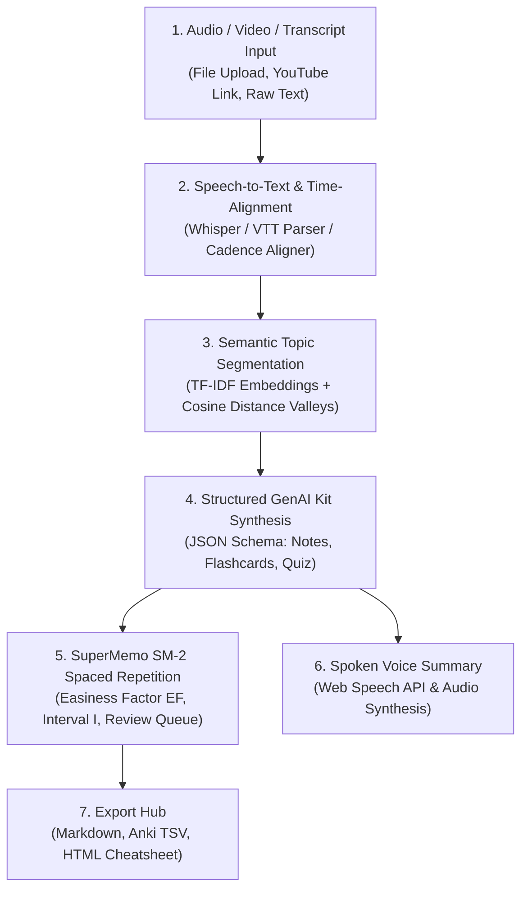

# System Architecture & Mathematical Foundations

**SynapseLecture AI (Day 24 of 30 Projects in 30 Days)**  
*Domain: EdTech + Speech + GenAI*

---

## 1. 6-Stage End-to-End Workflow Pipeline

---

## 2. Mathematical Modeling

### 2.1. Semantic Topic Boundary Detection (Depth Scoring)

Rather than splitting a lecture arbitrarily every 500 tokens (which bisects equations and concepts midway), SynapseLecture utilizes **Semantic Distance Valley Detection**:

1. **Windowed Vectorization:** For contiguous segments $s_1, s_2, \dots, s_N$, TF-IDF feature representations are computed:
   $$\mathbf{v}_i = \text{TF-IDF}(s_i)$$

2. **Cosine Semantic Distance:**
   $$d(i, i+1) = 1 - \frac{\mathbf{v}_i \cdot \mathbf{v}_{i+1}}{\|\mathbf{v}_i\| \|\mathbf{v}_{i+1}\|}$$

3. **Depth Score Formulation:** At candidate boundary point $k$:
   $$\text{Depth}(k) = \left( d_k - \min_{j \in [k-w, k]} d_j \right) + \left( d_k - \min_{j \in [k, k+w]} d_j \right)$$
   Where $w$ is the sliding context window. When $\text{Depth}(k) \ge \tau$ (percentile threshold) and duration constraints are met, a topic boundary is declared.

---

### 2.2. SuperMemo SM-2 Spaced Repetition Algorithm

To ensure knowledge transitions from short-term working memory to long-term synaptic retention, each flashcard is modeled as a dynamic dynamical system:

#### 1. Quality Grade ($q \in \{0, 1, 2, 3, 4, 5\}$)
Mapped in the user interface as:
- **Again ($q = 1$):** Complete recall failure.
- **Hard ($q = 3$):** Correct response recalled with significant difficulty.
- **Good ($q = 4$):** Correct response after hesitation.
- **Easy ($q = 5$):** Immediate, effortless recall.

#### 2. Easiness Factor Adjustment ($EF'$)
$$EF' = EF + \left(0.1 - (5 - q) \cdot (0.08 + (5 - q) \cdot 0.02)\right)$$
$$\text{Subject to: } EF' = \max(1.3, EF')$$

#### 3. Interval Scheduling ($I$)
$$\begin{cases}
I(0) = 1 \text{ day} & \text{if } q < 3 \text{ (lapse reset)} \\
I(1) = 1 \text{ day} & \text{if } q \ge 3 \text{ and } n = 0 \\
I(2) = 6 \text{ days} & \text{if } q \ge 3 \text{ and } n = 1 \\
I(n) = \text{round}(I(n-1) \times EF') & \text{if } q \ge 3 \text{ and } n \ge 2
\end{cases}$$

#### 4. Ebbinghaus Forgetting Curve Simulation
$$\hat{R}(t) = \exp\left(-\frac{t}{S \cdot 1.5}\right)$$
Where $S = I(n)$ is the memory stability factor (in days), and $t$ is days elapsed since last review.
